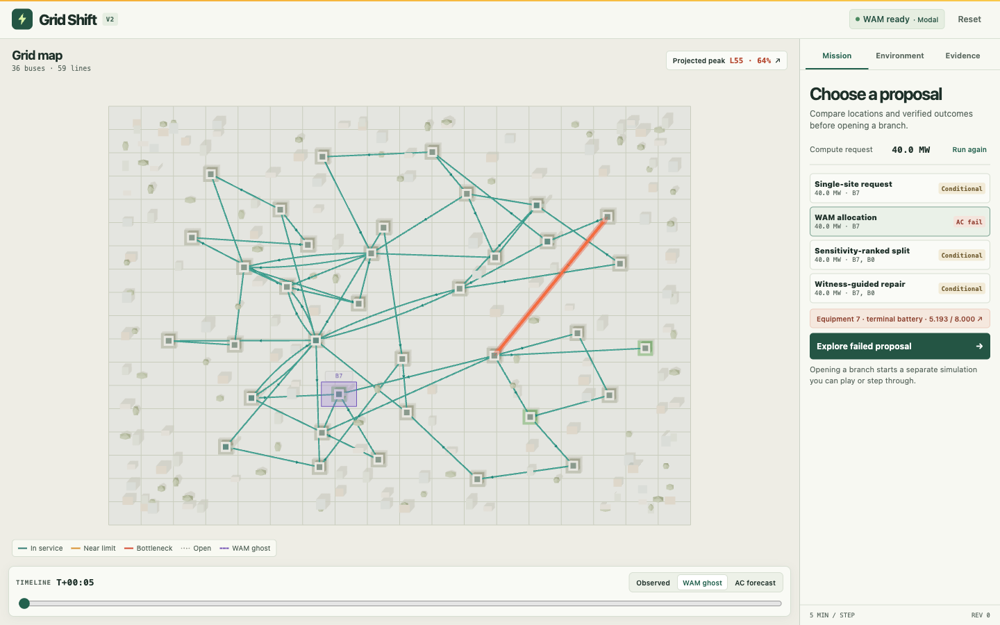
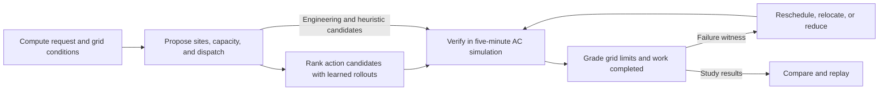

# Electrify

**Where can a data center connect, how many megawatts can the grid support, and what operating plan makes the connection feasible?**

Electrify is a connection-study tool built at SF × MIT Hack Day: Energy. It tests compute placement and dispatch against grid constraints, shows the equipment or service limit that failed, then tries a revised plan. You can replay each proposal in a 3D grid and compare the World Action Model's forecast with the AC simulation.

[Launch the live demo](https://electrify-demo.vercel.app) · [Read the evals](artifacts/gridshift-v2-wam-001/RESULTS.md) · [Run locally](#run-locally)



*Recorded benchmark study. The purple campus is a proposed placement. The timeline lets you switch between the learned forecast and the AC trace.*

## Try a connection study

1. Select **Training benchmark**, request **140 MW**, and click **Run connection study**. The planner checks each scenario with zero new compute first, so existing grid problems remain visible.
2. Compare the reference, WAM, and engineering proposals. Select a failed proposal to see the limiting equipment, measured value, and allowed limit. A **Conditional** result passed the scenarios where the zero-addition baseline was feasible.
3. Switch between **WAM ghost** and **AC forecast** when both are available. Use **Play recorded AC trace** or open a separate replay branch to step the simulation.
4. In **Advanced constraints**, change a branch rating or outage, demand, or battery availability. Run the study again and compare the results under the new constraints.

The training benchmark has 36 buses and 59 branches. Singapore and Northern Virginia are illustrative synthetic cases inspired by public regional data.

## How it works



- **Grid physics.** Grid2Op supplies the benchmark profiles. pandapower calculates bus voltages and branch flows. The simulator grades equipment limits and tracks battery energy and deferred-work deadlines.
- **World Action Model.** The PyTorch model has **57,964,080 parameters**, five graph message-passing blocks, and separate **768-dimensional GRU states** for buses and branches. It reads **12 five-minute snapshots** plus executed actions. Its heads score eligible buses, accepted capacity in 5% increments, and explicit operating commands. It predicts up to **12 future steps** for candidate actions.
- **Search and repair.** The planner compares WAM, heuristic, and engineering candidates. When a thermal limit blocks an immediate-processing plan, it can test deferring eligible work at the same site. If that repair fails, the planner can try a different site or a smaller request. Each revised plan goes back through AC verification. This loop updates the proposal during a study. Model training and refinement run separately.
- **Application.** FastAPI serves revision-bound studies and replay. React, TypeScript, and React Three Fiber render the grid. Modal runs training and learned inference.

## What the evals showed

| Eval | Measured result |
| --- | --- |
| **Temporary line derating** | At **105 MW** across 12 held-out demand profiles, immediate processing passed **0/12** and the AC-guided flexible schedule passed **12/12**, with zero missed deadlines or existing load loss. The flexible schedule passed **0/12** when the derating persisted. The deratings were constructed to test the scheduling mechanism. |
| **Capacity sweep** | In a separate sweep on one profile, **85 MW** was the highest fixed-processing level tested that passed. Flexible scheduling passed at **105 MW** at the same site. |
| **Forecast accuracy** | Across **396 one-step forecasts**, branch-loading mean absolute error was **6.49 percentage points** for the deployed WAM versus **1.03** for carrying forward the latest reading. |
| **Closed-loop control** | Of **18** held-out scenarios, **11** had a feasible zero-addition baseline. The deployed WAM passed **10/11**. The policy-only and workload-aware heuristic baselines each passed **11/11**. |

The measured capacity gain came from flexible workload scheduling and AC verification. The forecast and control evals have yet to show an advantage from learned rollouts. The connection results apply to the synthetic scenarios and operating assumptions tested. [Full methods, traces, and limitations](artifacts/gridshift-v2-wam-001/RESULTS.md)

## Run locally

Install Python 3.11, uv, and Node.js. From the repository root, start the API:

```sh
uv venv --python 3.11
uv pip install -r requirements-modal.txt
GRIDSHIFT_SMOKE=1 .venv/bin/python -m uvicorn gridshift.api:app --port 8000
```

In another terminal, start the frontend:

```sh
cd ui
npm ci
npm run dev
```

Open [localhost:5174](http://localhost:5174). This runs the AC simulator and heuristic controls with Grid2Op's packaged test profiles. For the full benchmark, checkpoint setup, and authenticated Modal inference, see the [runbook](V2-RUNBOOK.md). Model weights and generated datasets are stored separately.

From the repository root, run the AC parity and resource bookkeeping checks:

```sh
PYTHONPATH=. .venv/bin/python tests/check_resource_sim.py
```

| Looking for | Start here |
| --- | --- |
| Model and training | [Resource WAM](gridshift/model_v2.py), [graph backbone](gridshift/model.py), [training loop](gridshift/train_v2.py) |
| Simulation and planning | [Resource simulator](gridshift/sim_v2.py), [candidate search and repair](gridshift/planner_v2.py) |
| API and UI | [Study API](gridshift/api_v2.py), [mission workspace](ui/src/MissionV2.tsx) |
| Modal jobs and eval data | [Training jobs](modal_v2.py), [inference service](modal_inference.py), [evaluation artifacts](artifacts/gridshift-v2-wam-001/) |
